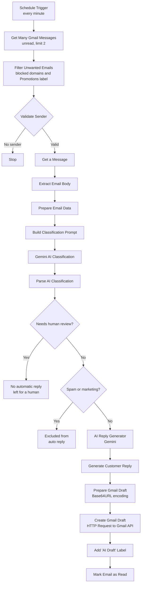

# AI Gmail Customer Support Automation

An n8n workflow that uses Gmail and Google Gemini to read incoming support emails, classify them, and prepare reply **drafts** for human review.

The workflow checks unread Gmail messages, filters out unwanted senders, classifies each inquiry by category, priority, and language, and generates a professional reply. It never sends anything automatically: every reply is saved as a Gmail Draft so a person stays in control of outgoing communication.

The goal is to reduce repetitive customer support work without removing human oversight.

---

## Table of Contents

- [Technologies](#technologies)
- [Workflow Architecture](#workflow-architecture)
- [Features](#features)
- [Examples](#examples)
- [Security and Reliability](#security-and-reliability)
- [Installation and Setup](#installation-and-setup)
- [Suggested Project Structure](#suggested-project-structure)
- [Future Improvements](#future-improvements)
- [Conclusion](#conclusion)

---

## Technologies

| Technology | Purpose |
|---|---|
| **n8n** | Workflow automation and orchestration |
| **Gmail API** | Retrieving emails, creating drafts, adding labels, marking messages as read |
| **Google Gemini API** | AI email classification and reply generation |
| **JavaScript** | Custom logic in n8n Code nodes |
| **Google OAuth2** | Authentication for Gmail operations |

**AI model:** `gemini-3-flash-preview`

---

## Workflow Architecture

Sequence of steps:

1. Schedule Trigger
2. Get Many Gmail Messages
3. Filter Unwanted Emails
4. Validate Sender
5. Get a Message
6. Extract Email Body
7. Prepare Email Data
8. Build Classification Prompt
9. Gemini AI Classification
10. Parse AI Classification
11. Check Human Review
12. Exclude Spam & Marketing
13. AI Reply Generator
14. Generate Customer Reply
15. Prepare Gmail Draft
16. Create Gmail Draft
17. Add AI Draft Label
18. Mark Email as Read



Two decision branches protect the reply path:

- Emails that **require human review** do not proceed to automatic reply generation.
- Emails classified as **spam or marketing** are excluded from the automatic reply process.

Only eligible customer inquiries reach reply generation and Gmail Draft creation.

---

## Features

### Automated Email Retrieval
- Checks Gmail periodically for unread messages.
- Scheduled trigger configured to run every minute.
- Retrieves up to 2 unread messages per execution (configurable in the Gmail node).

### Email Filtering
- Filters unwanted senders using a configurable blocked-domain list.
- Excludes emails carrying Gmail's Promotions category label.
- Validates that a sender exists before continuing.

### AI Email Classification

Gemini analyzes each email and returns structured JSON with:

- `category`
- `summary`
- `language`
- `priority`
- `confidence`
- `needs_human_review`
- `reason_for_review`

**Supported categories:** `account_access`, `technical_issue`, `billing`, `refund`, `order_status`, `general_inquiry`, `complaint`, `spam_or_marketing`, `other`

**Priority levels:** `low`, `medium`, `high`, `urgent`

### Human Review Detection

The AI flags unclear or sensitive messages. For example:

- "Problem with my order" with enough context can proceed to automatic reply generation.
- "Something wrong" with no further details requires human review.
- Security incidents and data breach notifications require human review.

Messages requiring human review do not proceed through the automatic draft-generation path.

### AI Reply Generation

Gemini generates a reply based on the original sender, the subject, the original body, the AI classification and summary, and the customer's original language.

The AI is instructed to:

- Be polite, clear, and concise.
- Ask for missing information when necessary.
- Never invent order details or company policies.
- Never claim that an action has been completed without confirmation.
- Return only the email body.

### Gmail Draft Creation

The workflow:

- Extracts the customer's email address.
- Prepares the reply with an appropriate subject.
- Encodes the message as Base64URL.
- Uses an HTTP Request node with the Gmail API to create the draft.

> **Important:** The workflow creates drafts only. It does not send emails automatically.

### Gmail Organization

After a draft is created successfully:

- The `AI Draft` label is added to the original email.
- The original email is marked as read.

---

## Examples

### Example 1: Order status inquiry

**Incoming email**

> **Subject:** Problem with my order
>
> Hello, I placed an order 5 days ago, but I haven't received any update. Can you help me check its status?

**AI classification**

| Field | Value |
|---|---|
| Category | `order_status` |
| Priority | `medium` |
| Needs human review | `false` |

**Generated reply (saved as a Gmail Draft)**

> Dear Customer,
>
> Thank you for reaching out to us. I understand that you are looking for an update on your order placed five days ago.
>
> To help me check the status for you, could you please provide your order number? Once I have that information, I will be able to look into this further.
>
> Best regards,
>
> Customer Support Team

This reply is **not sent**. It is saved as a draft in Gmail so a human can review, edit, and send it.

### Example 2: Vague message flagged for review

**Incoming email:** "something wrong"

The message has no usable details, so the AI sets `needs_human_review` to `true`. The workflow does **not** proceed to automatic reply generation, and a person handles it manually.

---

## Security and Reliability

**Implemented**

- Gmail access uses Google OAuth2 credentials.
- Gemini uses a configured API credential.
- Customer email content is treated as untrusted input.
- The AI is instructed not to follow malicious instructions embedded in incoming emails.
- Sensitive security-related messages require human review.
- The workflow does not send emails automatically.

**Good practice**

- Never commit API keys or credentials to GitHub. Store them in n8n Credentials, not inside nodes or Code nodes.
- Check the exported workflow JSON for sensitive values before publishing it.

**Known limitations**

- Advanced duplicate-draft prevention is not implemented.
- Emails flagged for human review or classified as spam/marketing are not marked as read, so they stay unread and may be re-evaluated on later runs, which can consume extra API quota.
- A complete centralized error-handling system is not implemented.
- The label and mark-as-read steps reference the first fetched message, so when several emails are processed in one run they may be applied to the wrong message. Processing items one at a time or using paired-item references is a planned fix.
- AI-generated drafts must always be reviewed before sending.
- The Gemini model is a preview model and may change.

This project is a portfolio demonstration and is not presented as production-ready.

---

## Installation and Setup

> **Warning:** Use synthetic test emails during development. Do not expose real customer information.

1. **Install or run n8n.** Use n8n Cloud or self-host it. See the [n8n documentation](https://docs.n8n.io/).
2. **Import the workflow.** In n8n, create a new workflow, open the menu, choose *Import from file*, and select the workflow JSON.
3. **Create a Gemini API key** in [Google AI Studio](https://aistudio.google.com/).
4. **Configure Gemini credentials** in n8n and attach them to the Gemini nodes.
5. **Set up Gmail OAuth2 credentials.** In Google Cloud Console, create an OAuth client, enable the Gmail API, and add your account as a test user if the app is in Testing mode. The redirect URL and exact values depend on your n8n deployment and Google Cloud configuration.
6. **Connect the nodes.** Assign the Gmail OAuth2 credential to the Gmail nodes. The HTTP Request node that creates drafts uses a Google OAuth2 API credential (a different credential type) with Gmail scopes.
7. **Configure the workflow.** Create an `AI Draft` label in Gmail and select it in the *Add AI Draft Label* node (label IDs are account-specific). Replace the placeholder blocked domains with your own, and review the schedule interval, message limit, and prompts.
8. **Test with sample emails.** Send yourself synthetic emails: a clear order inquiry, a vague message, and a marketing email.
9. **Verify the results.** Check that drafts appear in Gmail, that the `AI Draft` label is applied, and that vague or sensitive messages do not generate drafts.

---

## Suggested Project Structure

These are suggested files and folders, not a claim that they already exist.

```text
AI-Gmail-Customer-Support-Automation/
│
├── README.md
├── workflow/
│   └── gmail-customer-support.json
│
├── screenshots/
│   ├── workflow-overview.png
│   ├── ai-classification.png
│   └── gmail-draft.png
│
└── LICENSE
```

---

## Future Improvements

The following are **planned**, not implemented:

- Duplicate draft prevention
- Centralized error handling and notifications
- Human review queue
- Support for additional languages
- More advanced email categorization
- Analytics and reporting
- Improved logging and monitoring

---

## Conclusion

This project shows how n8n, Gmail, and Gemini can work together to triage support emails and prepare draft replies while keeping a human responsible for what gets sent. It demonstrates workflow design, structured AI output, conditional routing, Gmail API usage, and a safety-first approach to AI-generated communication.
